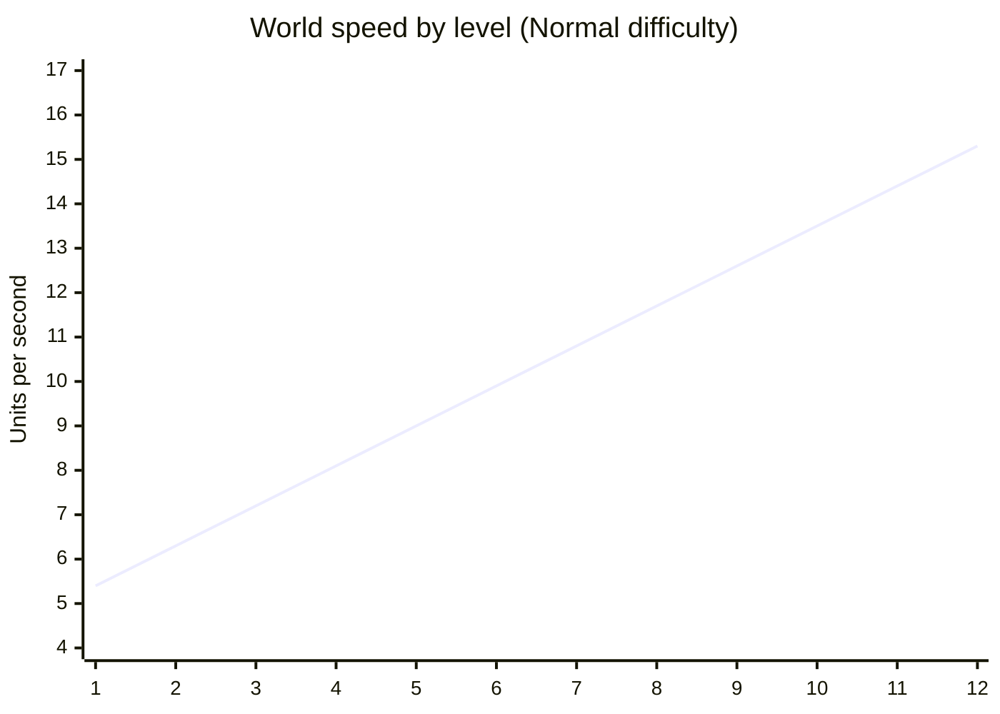
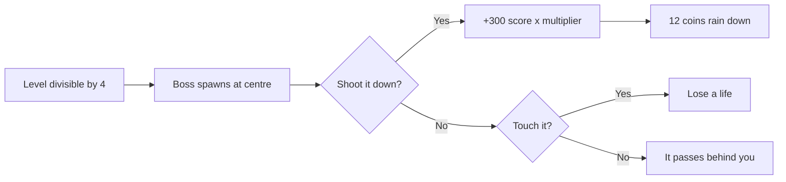
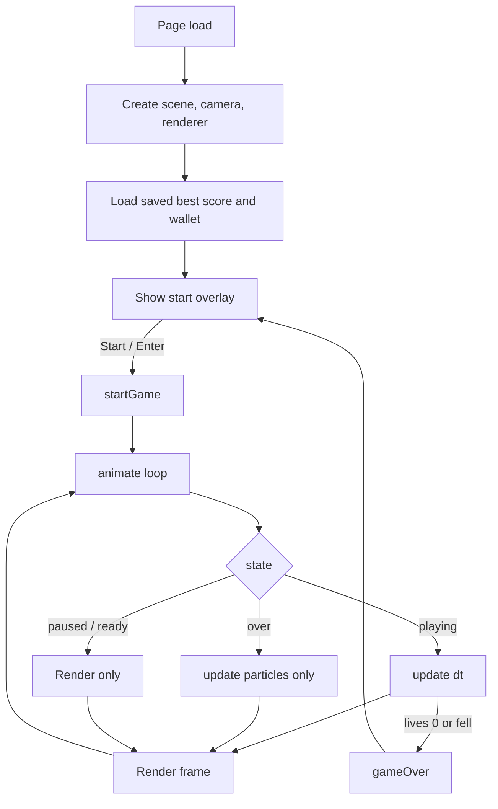
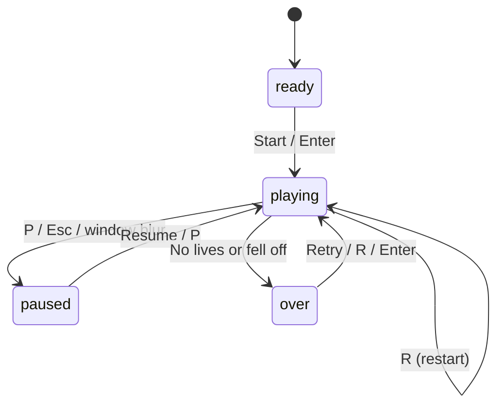
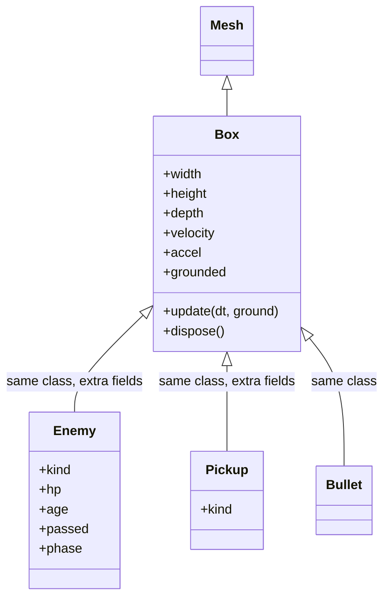

<div align="center">


# Cubestorm

**A fast, single-file 3D arcade survival game. Dodge or shoot the cubes, stay on the shrinking platform, and survive twelve increasingly savage levels.**

[](#-quick-start)
[](https://threejs.org/)
[](#-project-structure)
[](#-tech-stack)
[](#-license)


<br />


<sub>Replace the screenshots in <code>docs/screenshots/</code> with your own captures. See <a href="#-screenshots">Screenshots</a>.</sub>

</div>

---

## Table of Contents

- [Overview](#-overview)
- [Highlights](#-highlights)
- [Screenshots](#-screenshots)
- [Quick Start](#-quick-start)
- [How to Play](#-how-to-play)
- [Controls](#-controls)
- [Game Mechanics in Depth](#-game-mechanics-in-depth)
  - [Movement](#movement)
  - [Jumping and the double jump](#jumping-and-the-double-jump)
  - [Dash](#dash)
  - [Shooting and reloading](#shooting-and-reloading)
  - [Lives, damage and invulnerability](#lives-damage-and-invulnerability)
  - [Falling off the platform](#falling-off-the-platform)
- [Levels](#-levels)
- [Difficulty Modes](#-difficulty-modes)
- [Enemies](#-enemies)
- [Boss Fights](#-boss-fights)
- [Wall Attacks](#-wall-attacks)
- [Power-Ups](#-power-ups)
- [Coins and the Wallet](#-coins-and-the-wallet)
- [Scoring and Combos](#-scoring-and-combos)
- [Achievements](#-achievements)
- [Skins](#-skins)
- [Camera and Views](#-camera-and-views)
- [Audio](#-audio)
- [Visual Effects](#-visual-effects)
- [Gamepad Support](#-gamepad-support)
- [HUD Reference](#-hud-reference)
- [Persistence and Saved Data](#-persistence-and-saved-data)
- [Project Structure](#-project-structure)
- [Architecture](#-architecture)
- [Code Walkthrough](#-code-walkthrough)
- [Tuning and Configuration](#-tuning-and-configuration)
- [Customizing the Game](#-customizing-the-game)
- [Performance Notes](#-performance-notes)
- [Browser Compatibility](#-browser-compatibility)
- [Deployment](#-deployment)
- [Troubleshooting](#-troubleshooting)
- [FAQ](#-faq)
- [Known Limitations](#-known-limitations)
- [Roadmap](#-roadmap)
- [Contributing](#-contributing)
- [Code Style](#-code-style)
- [Built With Claude](#-built-with-claude)
- [Credits](#-credits)
- [License](#-license)

---

## 🌊 Overview

**Cubestorm** is a browser-based 3D arcade survival game. You control a cube on a floating platform while an ever-growing storm of enemy cubes rushes toward you. Every fifteen seconds the game moves to a new level: the world speeds up, the platform shrinks, new enemy types appear, and the music tempo climbs.

The entire game lives in **one HTML file**. There is no bundler, no package manager, no framework, and no asset download. All sound effects and music are synthesized at runtime with the Web Audio API, and all graphics are generated from Three.js primitives. Open the file and play.

<div align="center">

| Single file | Zero assets | Instant start |
| :---: | :---: | :---: |
| One `index.html` | Sound and visuals generated in code | Double-click and play |

</div>

### The core loop

1. **Survive** as the world accelerates.
2. **Dodge** by moving, jumping (twice if needed) or dashing.
3. **Shoot** enemies when dodging is too risky.
4. **Collect** coins and power-ups to extend your run.
5. **Chain** dodges into combos to multiply your score.
6. **Beat** a boss every fourth level.
7. **Unlock** achievements and save your best score.

---

## ✨ Highlights

<table>
<tr>
<td width="50%" valign="top">

### Gameplay
- 12 named levels with unique colour themes
- Endless mode after level 12 ("Endless Fury continues...")
- 4 difficulty modes: Easy, Normal, Hard, Insane
- 7 enemy types, including a boss
- Wall attacks with a two-cube gap
- Double jump and a directional dash
- Magazine-based shooting with reload
- Combo multiplier up to **x4**
- Bonus life every 5 levels

</td>
<td width="50%" valign="top">

### Polish
- Smooth chase camera with hit shake
- Optional first-person view with crosshair
- Particle bursts, screen flash and hit markers
- Animated starfield and lane markers for speed
- Smoothly blended level colour themes
- Fully synthesized sound effects and adaptive music
- Gamepad support
- Live FPS counter

</td>
</tr>
<tr>
<td width="50%" valign="top">

### Progression
- 6 power-ups: shield, slow-motion, double score, extra life, magnet, rapid fire
- Persistent coin wallet
- 5 player skins
- 8 achievements with toast notifications
- Persistent best score
- Detailed end-of-run statistics

</td>
<td width="50%" valign="top">

### Engineering
- Plain JavaScript, no build step
- Custom lightweight box physics
- Axis-aligned bounding box (AABB) collisions
- Object cleanup with geometry and material disposal
- Delta-time clamped to avoid physics blow-ups
- Auto-pause when the window loses focus
- Pixel ratio capped at 2 for performance

</td>
</tr>
</table>

---

## 📸 Screenshots

All screenshots are stored in [`docs/screenshots/`](docs/screenshots). The table below shows the filenames this README expects.

| Screenshot | File | Suggested capture |
| --- | --- | --- |
| Main menu | `docs/screenshots/menu.png` | The start overlay with the logo and difficulty buttons |
| Gameplay | `docs/screenshots/gameplay.png` | Third-person view at level 3 or 4 |
| First person | `docs/screenshots/first-person.png` | Press `C` and capture with the crosshair visible |
| Boss fight | `docs/screenshots/boss.png` | Level 4 with the boss health bar visible |
| Wall attack | `docs/screenshots/wall.png` | The "Wall incoming!" banner |
| Game over | `docs/screenshots/game-over.png` | The statistics summary |

<div align="center">


</div>

> **Tip:** On Windows press `Win + Shift + S`, on macOS press `Cmd + Shift + 4`, or use your browser's developer tools to capture a clean screenshot. Aim for 1280x720 or 1920x1080 and save as PNG.

### Game art included in this repository

The repository ships with vector artwork you can use right away.

<div align="center">


<br />


<br />


</div>

---

## 🚀 Quick Start

### Option 1: Open the file

1. Download or clone the repository.
2. Open `index.html` in a modern desktop browser.
3. Press **Start game** (or press `Enter`).

```bash
git clone https://github.com/YOUR-USERNAME/cubestorm.git
cd cubestorm
# then open index.html in your browser
```

### Option 2: Run a local server (recommended)

Some browsers apply stricter rules to `file://` pages, for example around `localStorage`. A tiny local server avoids all of that.

```bash
# Python 3
python -m http.server 8000

# Node.js
npx serve .

# PHP
php -S localhost:8000
```

Then visit `http://localhost:8000`.

### Option 3: VS Code Live Server

1. Install the **Live Server** extension.
2. Right-click `index.html`.
3. Choose **Open with Live Server**.

### Requirements

| Requirement | Details |
| --- | --- |
| Browser | A current desktop browser with WebGL support |
| Internet | Needed once per page load to fetch Three.js from the cdnjs CDN (see [Offline play](#offline-play)) |
| Input | Keyboard (mouse and gamepad optional) |
| Install | None |

### Offline play

The game loads Three.js r128 from a CDN:

```html
<script src="https://cdnjs.cloudflare.com/ajax/libs/three.js/r128/three.min.js"></script>
```

To play fully offline, download that file, place it next to `index.html` (for example `vendor/three.min.js`), and change the `src` attribute:

```html
<script src="vendor/three.min.js"></script>
```

---

## 🎮 How to Play

You are the bright cube near the front of the platform. Enemies spawn far away and rush toward you.

1. **Do not get touched.** Each hit costs a life. At zero lives the run ends.
2. **Do not fall.** Leaving the platform is an instant game over.
3. **Dodge** by moving sideways, forward or back, or jumping over smaller cubes.
4. **Shoot** with `F` or the left mouse button. You have 12 shots per magazine.
5. **Dash** with `Shift` to burst through enemies safely for a split second.
6. **Collect** gold coins for score and wallet currency, and coloured power-ups for temporary advantages.
7. **Survive** the level timer. Every 15 seconds the level increases.

### A good first run

- Stay near the middle of the platform until you learn the rhythm.
- Collect the gold coin trails; they are free points.
- Save your dash for walls and for the boss.
- Use `Q` to reload during quiet moments rather than waiting for the magazine to empty.
- Learn which colour is which. Orange cubes are fast, purple cubes are huge, and white cubes explode.

---

## 🕹️ Controls

### Keyboard and mouse

| Action | Keys |
| --- | --- |
| Move | `W` `A` `S` `D` or arrow keys |
| Jump | `Space` (press again in the air for a double jump) |
| Dash | `Shift` (left or right) |
| Shoot | `F` (hold) or left mouse button (hold) |
| Reload | `Q` |
| Toggle first-person view | `C` |
| Pause or resume | `P` or `Esc` |
| Mute or unmute | `M` |
| Retry | `R` |
| Start or restart from a menu | `Enter` |
| Choose difficulty (menu only) | `1` Easy, `2` Normal, `3` Hard, `4` Insane |
| Cycle player skin (menu only) | `K` |
| Toggle FPS counter | `F3` |

### Gamepad (standard mapping)

| Action | Input |
| --- | --- |
| Move | Left stick |
| Jump | `A` button (button 0) |
| Dash | `B` button (button 1) |
| Shoot | Right trigger (button 7) |

### Keyboard layout at a glance

```text
        ┌───┐                                 ┌───┐ ┌───┐ ┌───┐
        │ W │  forward                        │ Q │ │ C │ │ M │
    ┌───┼───┼───┐                             └───┘ └───┘ └───┘
    │ A │ S │ D │  left / back / right        reload  view  mute
    └───┴───┴───┘
 ┌─────────────────────────┐   ┌───────┐   ┌───┐   ┌───┐   ┌────┐
 │         SPACE           │   │ SHIFT │   │ F │   │ P │   │ F3 │
 │   jump / double jump    │   │ dash  │   │fire│  │pause│ │ FPS│
 └─────────────────────────┘   └───────┘   └───┘   └───┘   └────┘
```

---

## ⚙️ Game Mechanics in Depth

This section documents how the game actually behaves, based on the source code.

### Movement

- Movement is flat on the platform: left/right on the X axis, forward/back on the Z axis.
- Speed rises with level: `moveSpeed = 6.5 + level * 0.35`.
- Diagonal movement is normalized, so moving diagonally is not faster than moving straight.
- The player is clamped between `z = -16` and `z = 16` so you cannot run off the front or back of the play area.
- There is no horizontal clamp. Walking off the left or right edge of the platform will make you fall.

| Level | Move speed |
| :---: | :---: |
| 1 | 6.85 |
| 3 | 7.55 |
| 5 | 8.25 |
| 8 | 9.30 |
| 10 | 10.00 |
| 12 | 10.70 |

### Jumping and the double jump

| Property | Value |
| --- | --- |
| Gravity | `-22` units per second squared |
| First jump speed | `8.5` |
| Second (air) jump speed | `8.5 x 0.9 = 7.65` |
| Maximum jumps before landing | 2 |

The jump counter resets when you land. Using the second jump spawns a small white particle burst and plays a higher-pitched sound.

> Jumping is the cleanest answer to normal and fast cubes, but tall enemies such as the big purple cube and the boss are much harder to clear. Dodge those sideways.

### Dash

| Property | Value |
| --- | --- |
| Dash speed | `20` |
| Dash duration | `0.18 s` |
| Cooldown | `1.5 s` |
| Direction | Your last movement direction (defaults to forward) |

While dashing:

- You are **not damaged** by regular enemies. Colliding with one destroys it in a white burst.
- The **boss is not destroyed**: touching a boss while dashing does not hurt you, but the boss survives, so you simply pass through it.
- A trail of green-white particles follows you.

The HUD status line shows `Dash ready` or the remaining cooldown.

### Shooting and reloading

| Property | Value |
| --- | --- |
| Magazine size | `12` |
| Fire delay (normal) | `0.2 s` |
| Fire delay (rapid fire) | `0.08 s` |
| Reload time | `1.1 s` |
| Bullet speed | `45` units per second, straight ahead (-Z) |
| Bullet damage | 1 hit point |

- Hold `F` or the left mouse button for automatic fire.
- The magazine reloads automatically when it reaches zero. You can also reload manually with `Q` when it is not full.
- While **Rapid Fire** is active, shots cost no ammo.
- Picking up Rapid Fire also refills your magazine and cancels any reload in progress.
- Bullets travel straight along the Z axis from your current X position, so you must line up with the target.
- Accuracy is tracked as `hits / shots` and shown on the game-over screen.

### Lives, damage and invulnerability

- Lives depend on difficulty: Easy 5, Normal 3, Hard 2, Insane 1.
- The maximum is **5** lives.
- Getting hit removes one life, resets your combo to zero, resets your kill streak, shakes the screen and flashes red.
- After a hit you get **1.6 seconds** of invulnerability. Your cube blinks while it lasts, and enemies you touch are destroyed instead of hurting you.
- A **shield** absorbs one hit completely and does not break your combo.
- Every 5 levels (5, 10, 15, and so on) you earn a bonus life if you are below the maximum.

### Falling off the platform

If your Y position drops below `-8`, lives are set to zero and the run ends immediately with "You fell off the platform." Remember that the platform narrows as you advance.

---

## 🗺️ Levels

A new level begins every **15 seconds** (`LEVEL_TIME`). The twelve named levels each have their own background and floor colour. The scene colours blend smoothly from one level to the next.

| # | Name | Background | Floor | What changes |
| :---: | --- | :---: | :---: | --- |
| 1 | Calm Waters |  |  | Normal cubes only |
| 2 | Rising Tide |  |  | Fast cubes appear |
| 3 | Swift Current |  |  | Big cubes appear |
| 4 | Rapids |  |  | Bombs, walls and the **first boss** |
| 5 | Whirlpool |  |  | Zigzag cubes, bonus life |
| 6 | Storm Front |  |  | Enemies sometimes spawn in pairs |
| 7 | Thunder |  |  | Hopping cubes appear |
| 8 | Typhoon |  |  | **Second boss** |
| 9 | Abyss |  |  | Narrow platform, very fast |
| 10 | Maelstrom |  |  | Bonus life, platform at 7.5 wide |
| 11 | Chaos |  |  | Near-constant spawns |
| 12 | Endless Fury |  |  | **Third boss** |

After level 12 the game keeps going with the banner "Endless Fury continues...", reusing the final theme. Speed, spawn rate and platform shrinking keep following the formulas below, so the run only ends when you do.

### Difficulty curve formulas

| Quantity | Formula |
| --- | --- |
| World speed | `(4.5 + level * 0.9) * difficulty.speed` |
| Player move speed | `6.5 + level * 0.35` |
| Platform width | `max(6, 12 - (level - 1) * 0.5)` |
| Spawn interval | `max(0.28, 1.4 - 0.1 * (level - 1)) * difficulty.spawn` seconds |
| Bonus life | Every level divisible by 5 |
| Boss | Every level divisible by 4 |
| Wall attacks | From level 4 onward, every `max(6, 16 - level)` seconds |



### Platform width by level

| Level | 1 | 2 | 3 | 4 | 5 | 6 | 7 | 8 | 9 | 10 | 11 | 12 |
| --- | :---: | :---: | :---: | :---: | :---: | :---: | :---: | :---: | :---: | :---: | :---: | :---: |
| Width | 12.0 | 11.5 | 11.0 | 10.5 | 10.0 | 9.5 | 9.0 | 8.5 | 8.0 | 7.5 | 7.0 | 6.5 |

The width never goes below **6**, and the change is eased in smoothly rather than snapping.

---

## 🎚️ Difficulty Modes

Pick a difficulty on the start screen by clicking a button or pressing `1` to `4`.

| Mode | Key | World speed | Lives | Spawn interval | Intended for |
| --- | :---: | :---: | :---: | :---: | --- |
| Easy | `1` | x0.85 | 5 | x1.25 (slower spawns) | Learning the controls |
| Normal | `2` | x1.00 | 3 | x1.00 | The intended experience |
| Hard | `3` | x1.20 | 2 | x0.80 | Players who know the enemy types |
| Insane | `4` | x1.45 | 1 | x0.65 | One-life runs and bragging rights |

The best score is shared across all difficulties.

---

## 👾 Enemies

<div align="center">

</div>

All enemies run straight toward you along the Z axis with a small constant acceleration. Their speed gets a random bonus of up to 2 units on top of the world speed.

| Enemy | Colour | Appears | Size | Speed factor | Behaviour |
| --- | --- | :---: | :---: | :---: | --- |
| **Normal** | Red `#ef4444` | Level 1 | 0.8 to 1.6 | x1.0 | Straight line, the bread and butter |
| **Fast** | Orange `#f97316` | Level 2 | 0.6 to 0.9 | x1.7 | Small and quick, hard to react to |
| **Big** | Purple `#a855f7` | Level 3 | 2.2 to 2.8 | x0.7 | Slow but fills a third of the platform |
| **Bomb** | White `#f5f5f4` | Level 4 | 1.0 to 1.3 | x1.2 | Explodes when shot and destroys nearby cubes |
| **Zigzag** | Pink `#ec4899` | Level 5 | 0.9 to 1.1 | x1.0 | Sways left and right on a sine wave |
| **Hopper** | Dark red `#b91c1c` | Level 7 | 0.9 to 1.2 | x1.1 | Keeps jumping, so it can clear your low shots |
| **Boss** | Maroon `#7f1d1d` | Every 4th level | 4.0 | x0.45 | Many hit points, see [Boss Fights](#-boss-fights) |

### Spawn pool

The game picks an enemy kind at random from a pool that grows with level. Normal cubes are listed twice, so they are always the most common.

| Level | Pool contents |
| :---: | --- |
| 1 | normal x2 |
| 2 | normal x2, fast |
| 3 | normal x2, fast, big |
| 4 | normal x2, fast, big, bomb |
| 5 to 6 | normal x2, fast, big, bomb, zigzag |
| 7+ | normal x2, fast, big, bomb, zigzag, hopper |

From **level 6**, there is a 30 percent chance each spawn tick that a second enemy spawns alongside the first.

### Bombs

Shooting a bomb cube destroys it and triggers an explosion:

- Every non-boss enemy within a radius of **4 units** is also destroyed and counts as a kill.
- The screen shakes and a large orange particle burst plays.
- Bombs are a great way to clear a wall or a cluster of fast cubes.

> Bombs only explode when **shot**. If you touch one without a shield, it simply hurts like any other cube.

### Offscreen cleanup

Enemies are removed once they pass `z = 18` (behind the camera), and their geometry and materials are disposed to avoid memory growth.

---

## 👹 Boss Fights

A boss appears on levels **4, 8, 12 and every fourth level after that** (`BOSS_EVERY = 4`).

| Property | Value |
| --- | --- |
| Size | 4 x 4 x 4 |
| Hit points | `12 + level * 2` (20 at level 4, 28 at level 8, 36 at level 12) |
| Movement | Slides side to side on a sine wave, slowly advancing |
| Kill reward | 300 points (before multipliers) and a shower of 12 coins |
| Achievement | Boss slayer |

### Strategy

1. **Shoot it.** The boss is the only enemy that is really worth standing your ground against.
2. Keep your magazine topped up. A boss at level 8 takes 28 hits, which is more than two full magazines.
3. Grab **Rapid Fire** if you see it. It removes ammo and reload limits entirely.
4. **Dashing makes you safe but does not hurt the boss.** While you dash (or while you are invulnerable after a hit) you pass straight through it without taking damage, but it is not destroyed. Use a dash as an escape, not as an attack.
5. When the boss crosses the platform it is removed behind you. You do not lose a life for letting it pass, only for touching it.
6. A boss health bar appears at the top of the screen while it is alive.



---

## 🧱 Wall Attacks

From level 4, a **wall** of cubes periodically spawns across the full width of the platform with a **two-cube gap** you must reach.

- Each wall cube is 1.3 units wide, and the number of cubes adapts to the current platform width.
- The gap position is random (never at the extreme edges).
- Walls move at a steady `0.9 x world speed` with no acceleration, so you can plan your approach.
- The banner **"Wall incoming!"** warns you when one spawns.
- The first wall spawns after the initial 12-second timer, and later ones every `max(6, 16 - level)` seconds.

### How to beat a wall

| Method | Notes |
| --- | --- |
| Slip through the gap | Safest. Line up early. |
| Dash through | Destroys every cube you touch for 0.18 s. Strong but short. |
| Shoot a bomb | If a bomb spawns nearby, one shot can clear a section. |
| Use a shield | Absorbs a hit but still removes the cube you touched. |

---

## 🔋 Power-Ups

<div align="center">

</div>

Power-ups are glowing coloured cubes that slide toward you. One spawns every 11 to 16 seconds at a random X position.

| Power-up | Colour | Duration | Effect |
| --- | --- | :---: | --- |
| **Shield** | Cyan `#22d3ee` | Until hit | Absorbs the next hit. Your cube glows cyan while it is active. |
| **Slow** | Yellow `#fde047` | 6 s | Enemies move at half speed. Pickups, bullets and your own movement keep normal speed. |
| **Double** | Green `#4ade80` | 8 s | All score gains are doubled, stacking with your combo multiplier. |
| **Life** | Pink `#f472b6` | Instant | Adds one life, up to the maximum of 5. Only spawns while below max. |
| **Magnet** | Purple `#a78bfa` | 10 s | Pulls pickups within 10 units toward you. |
| **Rapid** | Orange `#fb923c` | 8 s | Shots cost no ammo and fire at 0.08 s intervals. Refills the magazine. |

### Tips

- **Slow + Rapid** is the strongest combination for boss fights.
- **Magnet** is best right after a coin trail spawns.
- **Double** pairs well with a long combo; try to catch it just before a stretch of tight dodging.
- A **Shield** is the best way to survive a wall you misjudged.

---

## 🪙 Coins and the Wallet

- Coin trails of 4 coins spawn every 3 to 5 seconds in a straight line.
- Each coin is worth `5 x score multiplier` points.
- Every coin is added to your **wallet**, which is saved in the browser and shown on the start screen.
- Killing a boss rains 12 extra coins.
- The "Coins" counter on the HUD shows coins collected in the current run.

The wallet persists between sessions. It is currently a collectable total; see the [Roadmap](#-roadmap) for plans to turn it into a shop currency.

---

## 🏆 Scoring and Combos

### Score sources

| Source | Points |
| --- | :---: |
| Survival | `5` per second |
| Dodge (enemy passes you) | `10` |
| Coin | `5` |
| Enemy kill | `15` |
| Boss kill | `300` |

Every source is multiplied by the current **score multiplier**.

### Combo multiplier

The combo counter goes up by one for each enemy that passes you without touching you. It resets to zero when you take damage.

```text
comboMultiplier = min(4, 1 + floor(combo / 5) * 0.5)
```

| Combo | Multiplier |
| :---: | :---: |
| 0 to 4 | x1.0 |
| 5 to 9 | x1.5 |
| 10 to 14 | x2.0 |
| 15 to 19 | x2.5 |
| 20 to 24 | x3.0 |
| 25 to 29 | x3.5 |
| 30+ | x4.0 (cap) |

The **Double** power-up multiplies on top, so the maximum possible multiplier is **x8**.

### Kill streaks

Kills in a row without taking damage trigger banners:

| Streak | Banner |
| :---: | --- |
| 5 | Killing spree! |
| 10 | Rampage! |

### End-of-run summary

The game-over screen reports:

- Final score and best score (with a "New best score!" note if applicable)
- Level reached
- Cubes dodged
- Coins collected
- Best combo
- Time survived in seconds
- Kills
- Shooting accuracy as a percentage

---

## 🎖️ Achievements

Achievements are checked continuously while you play and show a toast notification the first time they unlock. They are saved in the browser.

| Achievement | How to unlock |
| --- | --- |
| **Dodger** | Dodge 10 cubes in one run |
| **Untouchable** | Dodge 100 cubes in one run |
| **Collector** | Collect 25 coins in one run |
| **Level 5 reached** | Reach level 5 |
| **Level 10 reached** | Reach level 10 |
| **Sharpshooter** | Get 10 kills in one run |
| **Combo master** | Reach a combo of 20 |
| **Boss slayer** | Defeat a boss |

The start screen shows how many achievements you have unlocked.

---

## 🎨 Skins

There are five player colours. Press `K` on the start or game-over screen to cycle through them. Your selection is saved.

| # | Colour | Hex |
| :---: | --- | --- |
| 1 | Lime green (default) | `#00ff00` |
| 2 | Sky blue | `#38bdf8` |
| 3 | Pink | `#f472b6` |
| 4 | Yellow | `#facc15` |
| 5 | White | `#ffffff` |

---

## 🎥 Camera and Views

### Third-person (default)

A chase camera follows the player with smoothing:

- Position follows the player's X at 60 percent, so the world feels like it sways with you.
- Height is fixed at 5 units and sits 8 units behind the player.
- The camera looks at a point 6 units ahead of the player.
- Field of view is 70 degrees.
- Hits add a short random camera shake.

### First-person

Press `C` to switch. The camera moves inside the player cube, the field of view widens to 85 degrees, the player model is hidden, and a crosshair appears. The crosshair flashes red on a hit.

> Bullets always fly straight forward from your position, so the crosshair marks where your shots travel along the X axis.

---

## 🔊 Audio

There are **no audio files**. Everything is generated with the Web Audio API using oscillators and gain envelopes.

| Sound | Waveform | Trigger |
| --- | --- | --- |
| Jump | Square, sliding up | First jump |
| Double jump | Square, higher slide | Second jump |
| Shoot | Square, sliding down | Each shot |
| Reload | Two short square tones | Reload start |
| Land | Sine thump | Landing on the platform |
| Dodge | Triangle blip | An enemy passes you |
| Coin | Square chirp | Coin pickup |
| Power-up | Triangle sweep | Power-up pickup, achievements |
| Hit | Sawtooth drop | Taking damage |
| Shield | Sine drop | Shield absorbs a hit |
| Dash | Sawtooth rise | Dash |
| Boom | Low sawtooth | Explosions and boss spawn |
| Level up | Two rising triangle notes | New level |
| Game over | Layered sawtooth and square drop | Run ends |

### Music

A short bass line plays on a loop with triangle oscillators. The gap between notes shrinks with level:

```text
gap = max(110 ms, 240 ms - level * 12 ms)
```

So the music is slower at level 1 and noticeably more frantic by level 10. Press `M` to mute everything. Audio starts only after your first click or keypress, as browsers require.

---

## 💥 Visual Effects

| Effect | Where it appears |
| --- | --- |
| Starfield (300 points) | Rushes toward the camera, faster during play |
| Lane markers | 10 white dashes scrolling along the floor |
| Particle bursts | Hits, pickups, kills, double jumps, dash trail |
| Damage flash | Red inner glow around the screen |
| Hit marker | Crosshair turns red when a bullet connects |
| Screen shake | Damage, explosions, boss kills, level up |
| Player blink | During invulnerability |
| Player glow | Cyan emissive tint while shielded |
| Emissive pickups | Coins and power-ups glow |
| Level colour blend | Background, fog and floor colour fade between levels |
| Fog | Hides enemy spawn pop-in |
| Shadows | 2048 x 2048 shadow map from a directional light |

---

## 🎛️ Gamepad Support

Any controller that the browser exposes through the Gamepad API (the first connected pad is used) works:

| Input | Action |
| --- | --- |
| Left stick | Move (dead zone 0.2) |
| A (button 0) | Jump |
| B (button 1) | Dash |
| RT (button 7) | Fire |

Reload, pause, view switching and mute are keyboard-only for now. Some browsers require you to press a controller button once before the pad becomes visible.

---

## 🖥️ HUD Reference

| Element | Location | Shows |
| --- | --- | --- |
| Score | Top left | Current score |
| Level | Top centre | Level name and number |
| Best | Top right | Best score ever saved |
| Hearts | Under score | Remaining lives |
| Coins | Under hearts | Coins collected this run |
| Combo | Under coins | Combo and multiplier, shown from combo 2 |
| Status line | Under combo | Active power-ups, timers and dash cooldown |
| Progress bar | Bottom edge | Progress through the current 15 s level |
| Banner | Upper centre | Level names, warnings and streak messages |
| Boss bar | Top centre | Boss health while it is alive |
| Ammo | Bottom right | `ammo / 12`, `Reloading...` or `Rapid fire` |
| FPS | Bottom right corner | Frame rate, toggled with `F3` |
| Toast | Right | Achievements and view changes |

---

## 💾 Persistence and Saved Data

Data is stored in your browser with `localStorage`. Nothing is sent to any server.

| Key | Contents |
| --- | --- |
| `cubeDodgeBest` | Best score (number) |
| `cubestormMeta` | JSON with `wallet`, `skin` and `unlocked` achievements |

To reset your progress, open the browser console and run:

```js
localStorage.removeItem('cubeDodgeBest')
localStorage.removeItem('cubestormMeta')
location.reload()
```

All storage calls are wrapped in `try / catch`, so the game still works if storage is blocked (for example in some private-browsing modes), it just will not remember anything.

---

## 📁 Project Structure

```text
cubestorm/
├── index.html            # The entire game: markup, styles and script
├── README.md             # You are here
├── LICENSE               # MIT license (add this file)
├── assets/
│   ├── banner.svg        # README header art
│   ├── logo.svg          # Game logo (same artwork used in the menu)
│   ├── enemies.svg       # Enemy type chart
│   └── powerups.svg      # Power-up chart
└── docs/
    └── screenshots/      # Your gameplay screenshots (PNG)
```

> Save the game file as `index.html` so GitHub Pages can serve it with no extra configuration.

### Inside `index.html`

| Section | Contents |
| --- | --- |
| `<style>` | HUD, overlay, banner, crosshair, toast and flash styling |
| HTML body | HUD elements and the start/pause/game-over overlay with the inline SVG logo |
| `settings` | Constants such as gravity, level time and magazine size |
| `scene` | Renderer, camera, lights, ground, player, starfield |
| `Box` class | Mesh with velocity and simple ground physics |
| `sound` | Web Audio helpers, effects and music |
| `game state` | All mutable variables |
| `helpers` | Level look, particles, overlay handling |
| `shooting, boss, meta` | Bullets, bombs, boss, achievements, skins, FPS |
| `spawning` | Enemy, wall, coin and power-up creation |
| `gameplay events` | Collect, combo, damage, level up |
| `main update` | The per-frame simulation |
| `input` | Keyboard, mouse and gamepad |
| `main loop` | `requestAnimationFrame` and camera |

---

## 🏗️ Architecture

### High-level flow



### Game states



### Per-frame update order

```mermaid
flowchart LR
    A[Timers and level check] --> B[Gamepad and fire input]
    B --> C[Boss check and bullets]
    C --> D[Platform shrink]
    D --> E[Player movement and physics]
    E --> F[Fall check]
    F --> G[Spawn enemies, coins, powers, walls]
    G --> H[Enemy update and collisions]
    H --> I[Pickup update and collection]
    I --> J[Particles]
```



### Entity model



Enemies, pickups and bullets are all instances of `Box` with a few extra properties attached at spawn time. This keeps the code short and uses one collision routine for everything.

---

## 🧭 Code Walkthrough

### The `Box` class

`Box` extends `THREE.Mesh` and adds position helpers (`left`, `right`, `top`, `bottom`, `front`, `back`), velocity, optional Z acceleration, and a simple ground check:

```js
update(dt, ground) {
  const prevBottom = this.bottom
  this.velocity.z += this.accel * dt
  this.velocity.y += GRAVITY * dt
  this.position.x += this.velocity.x * dt
  this.position.y += this.velocity.y * dt
  this.position.z += this.velocity.z * dt
  // land only if falling, over the ground and coming from above
}
```

The landing test requires the cube to have been **above** the ground last frame, so you cannot be snapped up from the side or from below. Walk off the edge and you keep falling.

### Collisions

All collisions use axis-aligned bounding boxes:

```js
function boxCollision(a, b) {
  return (
    a.right > b.left && a.left < b.right &&
    a.top > b.bottom && a.bottom < b.top &&
    a.front > b.back && a.back < b.front
  )
}
```

It is used for player vs enemy, player vs pickup and bullet vs enemy.

### Delta time

```js
const dt = Math.min(clock.getDelta(), 0.05)
```

The clamp stops the simulation from taking giant steps after a tab was in the background, which prevents cubes teleporting through you.

### Level progression

```js
const newLevel = 1 + Math.floor(elapsed / LEVEL_TIME)
if (newLevel !== level) { level = newLevel; levelUp() }
```

Everything else (speed, spawn rate, music tempo, platform size, boss timing) is derived from `level`, so tuning a single formula changes the feel of the whole game.

### Memory management

Cubes are removed through a single helper:

```js
function removeFrom(list, index) {
  const obj = list[index]
  scene.remove(obj)
  obj.dispose()
  list.splice(index, 1)
}
```

Particles share one geometry and dispose only their own material. This keeps long runs stable.

### Slow-motion

The Slow power-up scales an `edt` ("enemy delta time") of 0.5 for enemy updates only, so you keep full control speed while the world slows down.

### Pause on blur

Switching tabs automatically pauses a running game, so you never come back to a dead run.

---

## 🔧 Tuning and Configuration

All of the main numbers live in the first block of the script:

```js
const GRAVITY = -22
const JUMP_SPEED = 8.5
const DASH_SPEED = 20
const GROUND_W = 12
const GROUND_D = 40
const SPAWN_Z = -20
const LEVEL_TIME = 15
const MAX_LIVES = 5
const MAG = 12
const BOSS_EVERY = 4
const SKINS = ['#00ff00', '#38bdf8', '#f472b6', '#facc15', '#ffffff']
```

| Constant | Effect of increasing it |
| --- | --- |
| `GRAVITY` (more negative) | Snappier, shorter jumps |
| `JUMP_SPEED` | Higher and longer jumps |
| `DASH_SPEED` | Longer dashes |
| `GROUND_W` | Wider platform at level 1 |
| `GROUND_D` | Longer platform |
| `SPAWN_Z` | Enemies appear further away, giving more reaction time |
| `LEVEL_TIME` | Slower level progression |
| `MAX_LIVES` | Higher life cap |
| `MAG` | More shots per magazine |
| `BOSS_EVERY` | Less frequent bosses |

Other tables you can edit directly: `LEVELS` (names and colours), `DIFFS` (speed, lives, spawn rate), `ENEMY` (colour, speed factor, size range) and `POWER` (colours).

---

## 🛠️ Customizing the Game

### Add a new level theme

```js
{ name: 'Neon Rush', bg: '#0a0a23', floor: '#ff00aa' }
```

Append it to the `LEVELS` array. The levels use the entries in order, and the last entry is reused beyond the end.

### Add a new difficulty

1. Add an entry to `DIFFS`, for example `nightmare: { speed: 1.7, lives: 1, spawn: 0.5 }`.
2. Add a button in the `#diff` container with `data-d="nightmare"`.

### Add a new skin

Push a colour onto the `SKINS` array. The `K` key cycles through all of them.

### Add a new enemy type

1. Add an entry to `ENEMY` with `color`, `speed`, `min` and `max`.
2. Add it to the pool in `pickEnemyKind()` at the level where it should appear.
3. Give it behaviour inside the enemy loop in `update()`, next to the `zig`, `boss` and `hop` cases.

### Add a new power-up

1. Add a colour in `POWER`.
2. Add the kind to the `kinds` array in `spawnPower()`.
3. Handle it in `collect()` and show it in `updateHud()`.

### Add an achievement

Add an entry to `ACHIEVEMENTS` with an `id`, a `text`, and an `ok()` function that returns `true` when it should unlock.

---

## 📈 Performance Notes

- The renderer pixel ratio is capped at 2 to protect high-DPI screens.
- Particles are capped at 250 at once and share a single geometry.
- The starfield is one `Points` object updated through a typed array.
- Shadows use a 2048 map; lower it to `1024` if you see slow frames on older GPUs.
- Disposing meshes on removal prevents GPU memory growth over long runs.
- Press `F3` to show or hide the live FPS counter.

### If the game runs slowly

1. Close other GPU-heavy tabs.
2. Make sure hardware acceleration is enabled in your browser.
3. Reduce `sun.shadow.mapSize` or turn off `renderer.shadowMap.enabled`.
4. Lower the pixel ratio to `1`.

---

## 🌐 Browser Compatibility

| Browser | Status |
| --- | --- |
| Chrome / Edge (current) | Supported |
| Firefox (current) | Supported |
| Safari (current) | Expected to work; test audio unlock behaviour |
| Mobile browsers | Loads, but there are **no touch controls yet** |

WebGL must be available. If you see a black page, check `chrome://gpu` or your browser's equivalent.

---

## 🚢 Deployment

### GitHub Pages

1. Push the repository to GitHub.
2. Open **Settings → Pages**.
3. Under **Build and deployment**, choose **Deploy from a branch**.
4. Select the `main` branch and the `/ (root)` folder.
5. Save. After a minute your game is live at `https://YOUR-USERNAME.github.io/cubestorm/`.

### Other static hosts

Because the game is a single static file, it works on Netlify, Vercel, Cloudflare Pages, itch.io (zip the folder as an HTML5 game) or any plain web server. No build command is needed and the output directory is the repository root.

### Create a release

```bash
git tag v1.0.0
git push origin v1.0.0
```

Then draw up a release on GitHub with the tag and attach a zip of `index.html` if you want a downloadable copy.

---

## 🩺 Troubleshooting

| Problem | Likely cause | Fix |
| --- | --- | --- |
| Blank or black page | No internet, so Three.js did not load | Connect, or self-host Three.js (see [Offline play](#offline-play)) |
| `THREE is not defined` in the console | CDN blocked by an extension or firewall | Allow `cdnjs.cloudflare.com` or self-host the library |
| No sound | Audio is created after the first interaction, or muted | Click Start, and press `M` to check mute |
| Best score does not save | `localStorage` blocked | Use a normal window or a local server |
| Controller not detected | Browser has not seen a button press yet | Press any button on the controller |
| Low FPS | Heavy shadow map or integrated GPU | See [Performance Notes](#-performance-notes) |
| Game pauses by itself | The window lost focus | Click back on the page and press Resume |
| `F3` opens search | Browser shortcut conflict | The game calls `preventDefault`, but some browsers override it |

---

## ❓ FAQ

**Is Cubestorm free?**
Yes, it is released under the MIT license.

**Does it need to be installed?**
No. Open `index.html` in a browser.

**Why is it a single file?**
It keeps the project easy to share, host and read. Splitting into modules is on the [roadmap](#-roadmap).

**Can I play on my phone?**
It will load, but there are no touch controls yet.

**Does the game collect any data?**
No. The only storage is your own browser's `localStorage`.

**What happens after level 12?**
The game keeps going. Speed and difficulty keep rising by the same formulas, and bosses keep appearing every fourth level.

**Do coins buy anything?**
Not yet. They accumulate in your wallet for a future shop.

**Is there a way to continue after dying?**
No. Press `R` or `Enter` to start a new run.

---

## ⚠️ Known Limitations

- No touch or on-screen controls for mobile devices.
- The wallet is collectable only; there is no shop yet.
- Skins are cosmetic colour swaps and can be cycled freely.
- Three.js is loaded from a CDN, so the first load needs a connection.
- Reload, pause, view toggle and mute are not mapped on gamepad.
- No automated tests; balance was tuned by hand.
- No online leaderboard; scores are local to the browser.

---

## 🗓️ Roadmap

- [x] Single-file playable game
- [x] 12 levels with changing themes
- [x] Four difficulty modes
- [x] Seven enemy types and boss fights
- [x] Six power-ups
- [x] Shooting, reload and first-person view
- [x] Achievements, wallet and skins
- [x] Gamepad support
- [ ] Touch controls and mobile layout
- [ ] Settings menu (volume, sensitivity, graphics quality)
- [ ] Shop where coins unlock skins
- [ ] Local leaderboard with multiple entries
- [ ] Challenge mode with hand-made levels
- [ ] Split into ES modules (optionally TypeScript)
- [ ] Self-hosted Three.js for offline play
- [ ] Automated tests for the scoring and level formulas
- [ ] Optional online leaderboard

Have an idea? [Open an issue](../../issues).

---

## 🤝 Contributing

Contributions are welcome.

1. **Fork** the repository.
2. Create a branch: `git checkout -b feature/amazing-idea`.
3. Make your changes and **play-test** them.
4. Commit with a clear message: `git commit -m "Add amazing idea"`.
5. Push: `git push origin feature/amazing-idea`.
6. Open a **Pull Request** describing what changed and why.

### Good first contributions

- Touch controls
- New enemy behaviours
- New level themes
- Balance tweaks, with a short note on what you measured
- Accessibility improvements such as reduced motion and colour-blind palettes
- Screenshots and GIFs for this README

### Bug reports

Please include your browser and version, your operating system, the steps to reproduce, and any console errors.

---

## 🧹 Code Style

The project uses Prettier with these options:

```json
{
  "singleQuote": true,
  "semi": false,
  "trailingComma": "none",
  "overrides": [{ "files": "*.html", "options": { "parser": "html" } }]
}
```

Run `npx prettier --write index.html` before committing.

---

## 🤖 Built With Claude

You asked for a note on why Claude is mentioned here, so here it is, plainly.

**Claude** is an AI assistant made by [Anthropic](https://www.anthropic.com/). Cubestorm was developed in conversation with Claude: the game began as a small Three.js cube-dodge prototype, and Claude helped iterate it into the version you see here by fixing bugs, adding sound, scoring and retry, and layering in features such as levels, enemy types, power-ups, a boss, shooting and a first-person view. Claude also wrote this README.

### Why credit Claude?

- **Transparency.** People reading the repository deserve to know how it was made.
- **Reproducibility.** Anyone can start from a similar conversation and extend the project the same way.
- **Honest credit.** The ideas, direction, and decisions about what the game should be came from the human author; Claude contributed code and documentation. Both are part of the story.

### What Claude does not replace

Claude can make mistakes. The numbers in this README were written from reading the source code, not from automated tests, so if you find a mismatch between this document and the game, trust the game and please open an issue or a pull request.

---

## 🙏 Credits

- **Game design and direction:** the repository author
- **Code and documentation assistance:** [Claude](https://www.anthropic.com/claude) by Anthropic
- **3D engine:** [Three.js](https://threejs.org/) (MIT)
- **Badges:** [Shields.io](https://shields.io/)
- **Hosting for the library:** [cdnjs](https://cdnjs.com/)

---

## 📄 License

Released under the **MIT License**.

```text
MIT License

Copyright (c) 2026 YOUR NAME

Permission is hereby granted, free of charge, to any person obtaining a copy
of this software and associated documentation files (the "Software"), to deal
in the Software without restriction, including without limitation the rights
to use, copy, modify, merge, publish, distribute, sublicense, and/or sell
copies of the Software, and to permit persons to whom the Software is
furnished to do so, subject to the following conditions:

The above copyright notice and this permission notice shall be included in all
copies or substantial portions of the Software.

THE SOFTWARE IS PROVIDED "AS IS", WITHOUT WARRANTY OF ANY KIND, EXPRESS OR
IMPLIED, INCLUDING BUT NOT LIMITED TO THE WARRANTIES OF MERCHANTABILITY,
FITNESS FOR A PARTICULAR PURPOSE AND NONINFRINGEMENT. IN NO EVENT SHALL THE
AUTHORS OR COPYRIGHT HOLDERS BE LIABLE FOR ANY CLAIM, DAMAGES OR OTHER
LIABILITY, WHETHER IN AN ACTION OF CONTRACT, TORT OR OTHERWISE, ARISING FROM,
OUT OF OR IN CONNECTION WITH THE SOFTWARE OR THE USE OR OTHER DEALINGS IN THE
SOFTWARE.
```

<div align="center">

**If you enjoyed Cubestorm, please give the repository a ⭐**

<sub>Dodge. Shoot. Survive the storm.</sub>

</div>
